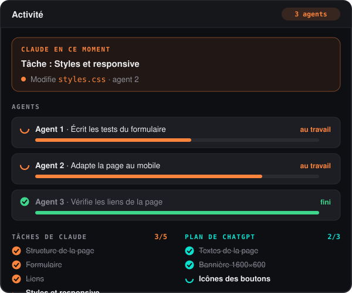
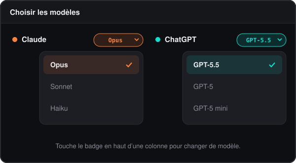
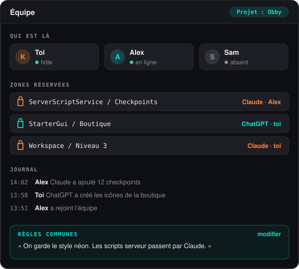
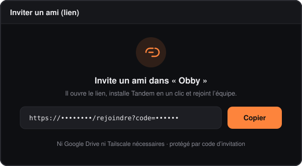
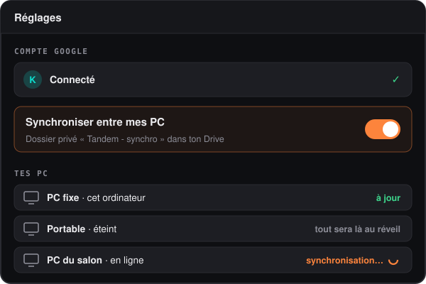

# TANDEM

---

### Claude et ChatGPT, côte à côte

Deux IA dans **une seule fenêtre**, qui se parlent, se passent leurs fichiers et avancent **ensemble** sur tes projets : code, images, jeux, exposés…

 

  

Un seul installateur · Tandem se met ensuite à jour tout seul

  

[Aperçu](#-aperçu) · [En bref](#-en-bref) · [Démarrer](#-démarrer-en-3-étapes) · [Fonctions](#-ce-que-tu-peux-faire) · [Exemples](#-exemples) · [Aide](#-aide) · [Nouveautés](https://github.com/SKaith95/tandem/releases)

 

 

## ✨ En bref

<table>
<tr>
<td width="33%" valign="top">

### 🤝 Deux IA, une fenêtre
Claude à gauche, ChatGPT à droite, sur **la même conversation**. Tu écris une fois, les deux s'y mettent.

</td>
<td width="33%" valign="top">

### 💬 Elles se parlent
En plein travail, Claude peut poser une question à ChatGPT (`@@ChatGPT`). La réponse lui revient **sans attendre la fin**.

</td>
<td width="33%" valign="top">

### 🗂️ Un espace partagé
Les fichiers et images créés par l'une sont **retrouvés par l'autre**, rangés sous les noms demandés.

</td>
</tr>
<tr>
<td valign="top">

### 📋 Panneau Activité
Les **agents** de Claude au travail, ce que chacun fait à l'instant, la liste de tâches de Claude et le plan de ChatGPT (3/7…).

</td>
<td valign="top">

### 🧠 Choisis tes modèles
Touche le badge en haut d'une colonne : **Opus, Sonnet, Haiku** pour Claude, **GPT-5.5, GPT-5, GPT-5 mini** pour ChatGPT.

</td>
<td valign="top">

### 👥 En équipe
Invite un ami avec **un simple lien**. Les IA de l'équipe réservent ce qu'elles modifient : **personne n'écrase le travail d'un autre**.

</td>
</tr>
<tr>
<td valign="top">

### 🔄 Synchro entre tes PC
Conversations, fichiers et captures te suivent d'un PC à l'autre, via un **dossier privé** de ton Google Drive.

</td>
<td valign="top">

### 🧩 Skills
Méthodes **Roblox Studio, animations, Blender, contrôle du PC** : chargées seulement quand Claude en a besoin.

</td>
<td valign="top">

### 💸 Économe en tokens
Claude garde sa session, les vieux messages sont résumés : environ **3 fois moins de tokens** dans les longues conversations.

</td>
</tr>
</table>

 

## 🚀 Démarrer en 3 étapes

| | Étape | Détail |
|:-:|---|---|
| **1** | **Télécharge Tandem** | Un seul fichier : [`Tandem-Setup.exe`](https://github.com/SKaith95/tandem/releases/latest/download/Tandem-Setup.exe) (Windows). |
| **2** | **Installe-le** | Ouvre le fichier et suis l'installation. |
| **3** | **C'est tout** | Tandem télécharge les nouvelles versions en arrière-plan et te propose **« Mettre à jour »**. |

> [!NOTE]
> Si Windows affiche **« Windows a protégé votre ordinateur »**, clique sur **Informations complémentaires**, puis **Exécuter quand même**.

> [!TIP]
> Pour installer Tandem chez un ami, envoie-lui simplement ce lien : 
> `https://github.com/SKaith95/tandem/releases/latest/download/Tandem-Setup.exe`

 

## 🧭 Ce que tu peux faire

<table>
<tr>
<td width="50%"></td>
<td width="50%" valign="middle">

### Tout voir pendant que ça travaille

- **Claude en ce moment** : la tâche en cours et l'action qu'il fait à l'instant, avec l'agent qui la fait.
- **Agents** : ceux qui travaillent, leur mission, ce qu'ils font, et quand ils ont fini.
- **Tâches et plan** : la liste de Claude et le plan de ChatGPT, avec leur avancement (3/5…).
- **Pastille orange** sur le bouton Activité : combien d'agents sont au travail.
- **Pas de coupure** : la session reste ouverte jusqu'à ce que **tous** les agents aient fini.

</td>
</tr>
</table>

<table>
<tr>
<td width="50%" valign="middle">

### Le bon modèle pour chaque tâche

- **Touche le badge** en haut d'une colonne pour changer de modèle.
- **Claude** : Opus, Sonnet ou Haiku.
- **ChatGPT** : GPT-5.5, GPT-5 ou GPT-5 mini.
- **Skills** : Roblox Studio, animations, Blender et contrôle du PC ne sont chargés **que quand Claude en a besoin**.

</td>
<td width="50%"></td>
</tr>
</table>

<table>
<tr>
<td width="50%"></td>
<td width="50%" valign="middle">

### Une équipe, sans conflits

- **Partage un projet** : menu du jeu › **« Partager ce jeu en équipe »**.
- **Réservations** : chaque IA réserve ce qu'elle modifie (un script, une interface, une partie de la map). **Personne n'écrase le travail d'un autre.**
- **Panneau Équipe** : qui est là, les zones réservées, le journal de qui a fait quoi, et les règles communes (modifiables).
- **Mémoire commune** : tout le monde partage la mémoire du projet.

</td>
</tr>
</table>

<table>
<tr>
<td width="50%" valign="middle">

### Inviter en un lien

- Menu du jeu › **« Inviter un ami (lien) »**.
- Ton ami ouvre le lien, **installe Tandem en un clic** et rejoint l'équipe.
- Il n'a besoin **ni de Google Drive ni de Tailscale** : ton Tandem héberge l'équipe, en temps réel.
- Seule la partie « équipe » est ouverte sur internet, protégée par le **code d'invitation**.

</td>
<td width="50%"></td>
</tr>
</table>

<table>
<tr>
<td width="50%"></td>
<td width="50%" valign="middle">

### Tes PC, toujours à jour

- Réglages › Compte Google › **« Synchroniser entre mes PC »**, sur chaque PC.
- Conversations, fichiers, captures et jeux passent par un dossier **privé** de ton Drive, séparé de celui de tes amis.
- Tu retrouves tout, **même si l'autre PC est éteint**.
- Modifiée sur deux PC ? Tandem **garde les messages des deux**.

</td>
</tr>
</table>

Les écrans ci-dessus sont des illustrations de l'interface.

> [!IMPORTANT]
> **Tes conversations et ton PC restent privés.** Seule la partie « équipe » passe par internet, et seulement si tu partages un projet.

 

## 💡 Exemples

| Tu demandes… | Claude | ChatGPT |
|---|---|---|
| *« Crée la page d'accueil de mon app »* | Code la page, le formulaire, les tests | Écrit les textes, génère la bannière |
| *« Ajoute une boutique à mon jeu Roblox »* | Scripte la boutique dans Roblox Studio | Dessine les icônes des objets |
| *« Anime mon personnage »* | Prépare l'animation (Blender, Roblox) | Propose les poses et les références |

 

## ❓ Aide

<b>Windows affiche « Windows a protégé votre ordinateur »</b>

 
Clique sur <b>Informations complémentaires</b>, puis <b>Exécuter quand même</b>.

<b>Comment mettre à jour Tandem ?</b>

 
Rien à faire : Tandem télécharge la nouvelle version en arrière-plan, puis te propose <b>« Mettre à jour »</b>.

<b>Où voir les nouveautés ?</b>

 
Chaque version est détaillée dans les <a href="https://github.com/SKaith95/tandem/releases">Releases</a>.

 

## 📦 À propos de ce dépôt

Ce dépôt contient **uniquement les installateurs** de Tandem. Les nouveautés de chaque version sont détaillées dans les **[Releases](https://github.com/SKaith95/tandem/releases)**.

 
Fait par <a href="https://github.com/SKaith95">Kais</a> · Epitech

